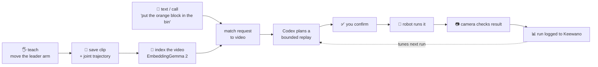
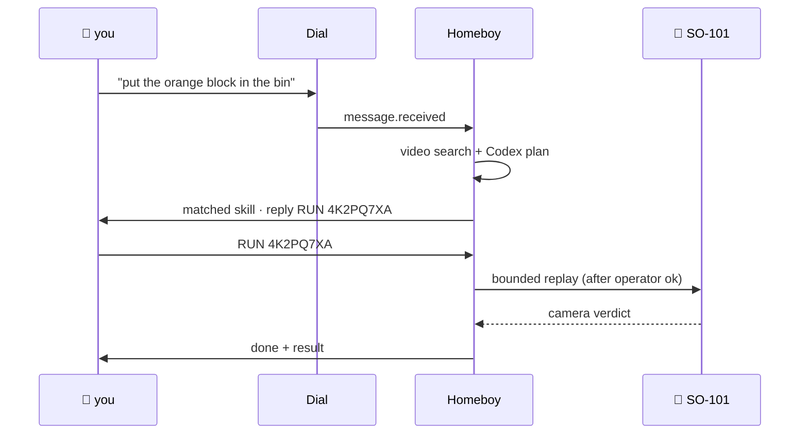
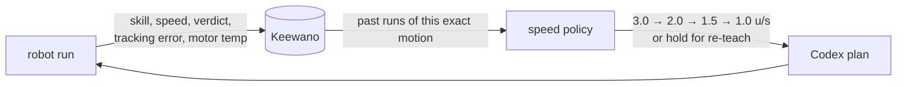
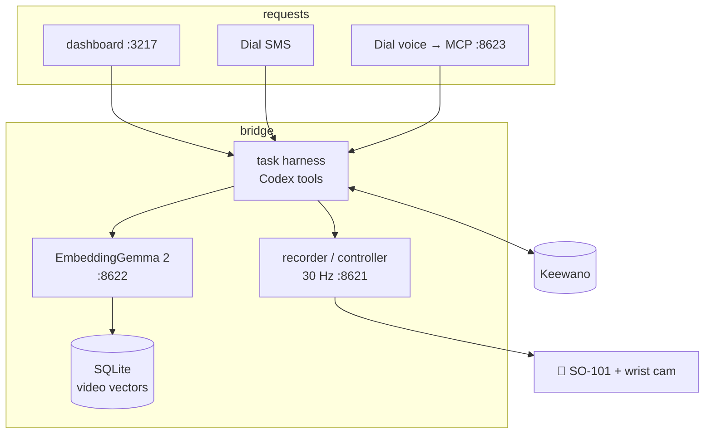

# Homeboy

teach a robot a chore once. text it later. it does the chore.

Homeboy is a teach-and-recall app for the SO-101 arm. you show it a task with the leader arm, it saves the clip, and later you can text or call it in plain english. it finds the right demo by *watching the video*, plans a bounded replay, asks for your ok, runs it, and tells you how it went.

built at SpeedHacks (Oct 11, 2026).

---

## the problem

i hate doing the same tabletop chores over and over. robot arms are cheap now, but getting one to do a task still means one of two things:

- **write the motion yourself.** waypoints, IK, tuning. hours per task.
- **train a policy.** hundreds of demos and a GPU you don't have.

and even when it works, nobody remembers which recording was the good one, you have to be at the laptop to kick it off, and when it fails there's no record of why.

## the solution

skip both. teach once, then recall.



1. **teach.** move the leader arm through the task. the follower copies it, the wrist cam records it.
2. **index.** 8 frames from the clip go straight into EmbeddingGemma 2. no titles, no captions, just pixels. search matches your words against what the camera actually saw.
3. **ask.** text or call the robot's Dial number. it finds the matching demo, or tells you it doesn't know that one.
4. **plan.** Codex gets a small toolbox (retrieve skills, read motors, read logs, build program) and builds a speed-capped replay of the taught trajectory. it can't send raw joint commands.
5. **confirm + run.** you reply `RUN XXXXXXXX`, the operator checks the cell, the arm goes. a local vision model compares before/after frames.
6. **learn.** every run lands in Keewano. next time that skill is planned, the harness reads its history and slows down if it's been flaky.

---

## sponsor prizes

### 📱 Dial — the robot has a phone number

the robot shouldn't need a laptop to take requests. Dial is the front door.



- **SMS** ([`dial_sms.py`](bridge/scripts/dial_sms.py)): listens on Dial's event stream, plans through the same harness as the dashboard, sends a sender-bound RUN token that expires in 5 min. duplicate events never trigger a second run.
- **voice** ([`dial_voice_mcp.py`](bridge/scripts/dial_voice_mcp.py)): call the number and Dial's voice agent talks to Homeboy through a Context MCP with two tools, `willow_status` and `willow_plan_task`. it can check readiness and plan, but it **can't** start motion.
- allowlisted callers/senders only. phone numbers get hashed before they hit any log.

details: [DIAL_SMS.md](bridge/DIAL_SMS.md) · [DIAL_VOICE.md](bridge/DIAL_VOICE.md)

### 📊 Keewano — the robot remembers how it did

most robot demos run and forget. we send every run to Keewano and read it back before the next one.



- **export:** one entity per request, so planning + execution share a timeline. typed events from both Python (harness, SMS) and Node (dashboard search).
- **read back:** at plan time, query past verdicts for the same motion hash, grouped by replay speed.
- **adapt:** pick the fastest speed that isn't failing (<60% success over 3+ runs, or avg tracking error ≥ 6). all bad → hold the skill until someone re-teaches it.
- **explain:** Codex calls `read_run_analytics` and the plan panel shows *why* it picked that speed.

Keewano can only slow a skill down or hold it. never speeds it up, never touches the trajectory, never skips a safety gate. if it's down, the harness falls back to the default speed and says so.

we also trace our own Claude Code sessions into the same project via hooks, so the agent that built this is in the data too.

details: [keewano/README.md](bridge/keewano/README.md) · [run_analytics.py](bridge/scripts/run_analytics.py)

### also built with

- **Google EmbeddingGemma 2** — native video embeddings, running locally on the Mac. no hosted API.
- **OpenAI Codex** (app-server) — tool-calling planner. max 8 tool calls per turn, shell/browser/plugins disabled.
- **Ollama + gemma3:4b** — local vision check on before/after frames.
- **LeRobot** — SO-101 drivers, calibration, episode format.
- **Next.js** — dashboard with the live SO-101 URDF.

---

## architecture



## run it

```bash
cd frontend && npm install && npm run dev
```

open http://127.0.0.1:3217. the bridge (`:8621`) and embedding service (`:8622`) start on demand.

one-time video search setup (needs Python 3.12, `uv`, `ffmpeg`):

```bash
uv venv --python 3.12 .embedding-venv
```

```bash
uv pip install --python .embedding-venv/bin/python -r bridge/embedding-requirements.txt
```

secrets go in `bridge/.env.local` (copy from `.env.example`). hardware setup is in [frontend/README.md](frontend/README.md) and [HARNESS.md](bridge/HARNESS.md).

## what it doesn't do (yet)

keeping this honest:

- **replays, doesn't generalize.** move the block or the bin and it won't adapt. same workcell as the demo or it refuses.
- **one task proven in the pipeline.** retrieval works on our clip (0.78 for the right query, unrelated ones rejected), but the 0.65 threshold isn't calibrated across many skills yet.
- **camera verdict is provisional.** the vision model can be wrong. it's evidence, not ground truth.
- **a human always confirms.** text can request and consent, but the operator presses run.

evidence: [video retrieval](bridge/VIDEO_RETRIEVAL_VERIFICATION.md) · [hackathon plan + checkpoints](HACKATHON_PLAN.md)

## next

more taught skills so the retrieval threshold means something, then a real grasp controller so moved objects stop being a dealbreaker.
